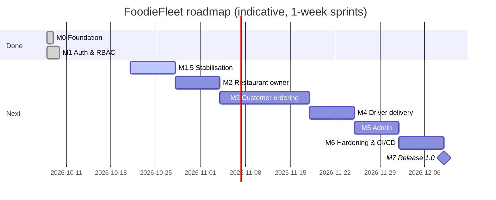

# FoodieFleet — Software Development Life Cycle Plan

> Status as of **2026-10-20** · Branch `main-dev` · Version `0.0.1-SNAPSHOT`

This document is the master plan for building FoodieFleet. It follows a
**phased (iterative) SDLC**: each milestone passes through
*Requirements → Design → Implementation → Testing → Deployment → Maintenance*
before the next one starts, so there is always a working, deployable build.

Detailed documentation for each SDLC stage lives in [`docs/`](docs):

| SDLC stage | Document |
|---|---|
| 1. Planning & Analysis | this file (§1–§3) |
| 2. Requirements | [docs/01-requirem/ents.md](docs/01-requirements.md) |
| 3. Design | [docs/02-architecture.md](docs/02-architecture.md) |
| 4. Implementation | [docs/03-implementation.md](docs/03-implementation.md), [CONTRIBUTING.md](CONTRIBUTING.md) |
| 5. Testing | [docs/04-testing.md](docs/04-testing.md) |
| 6. Deployment | [docs/05-deployment.md](docs/05-deployment.md) |
| 7. Maintenance | [docs/06-maintenance.md](docs/06-maintenance.md), [CHANGELOG.md](CHANGELOG.md) |
| Cross-cutting: Security | [SECURITY.md](SECURITY.md) |

---

## 1. Project overview

**FoodieFleet** is a food-delivery platform with four roles:

| Role | Goal |
|---|---|
| `CUSTOMER` | Browse restaurants, order food, track the order |
| `RESTAURANT_OWNER` | Manage restaurant profile and menu, accept and prepare orders |
| `DRIVER` | Pick up ready orders and deliver them |
| `ADMIN` | Moderate users and restaurants, view platform metrics |

**Tech stack:** Java 17 · Spring Boot 3.2.5 (Web, Security, Data JPA, Mail,
Thymeleaf) · PostgreSQL 15 · Lombok · Maven · Docker / Docker Compose.

**Architecture style:** server-rendered MVC monolith (Thymeleaf + session-based
Spring Security). A REST/JWT API is planned for a later phase (see M8).

---

## 2. Current-state analysis

### 2.1 What exists

| Area | State | Notes |
|---|---|---|
| Domain model | ✅ Done | `User`, `Role`, `Restaurant`, `MenuItem`, `Order`, `OrderItem`, `OrderStatus`, `VerificationToken` |
| Repositories | ✅ Done | One per aggregate |
| Registration + login | ✅ Done | BCrypt, form login, role-based redirect after login |
| Email verification | ✅ Done | Async email over Gmail SMTP, token valid for 24 h |
| RBAC route guards | ✅ Done | `/customer/**`, `/restaurant/**`, `/driver/**`, `/admin/**` |
| Restaurant owner module | 🟡 In progress (uncommitted) | Controller + service written; templates missing |
| Customer module | ⬜ Placeholder | Returns a hard-coded HTML string |
| Driver module | ⬜ Placeholder | Returns a hard-coded HTML string |
| Admin module | ⬜ Not started | Route exists in security config only |
| Orders | ⬜ Not started | `OrderService`, `CreateOrderRequest`, `OrderResponse` are empty files |
| Error handling | ✅ Done (M1.5) | `GlobalExceptionHandler` + `error.html` |
| JWT | ⬜ Deferred to M8 | Empty stubs removed in M1.5 |
| Tests | 🟡 Started (M1.5) | 18 tests: auth unit tests + security/registration integration tests on Testcontainers |
| CI/CD | ⬜ None | |
| DB migrations | ✅ Done (M1.5) | Flyway `V1__init.sql`; Hibernate `ddl-auto=validate` |
| Containerisation | ✅ Done | Multi-stage Dockerfile + Compose (app on 8081, DB on 5433) |

### 2.2 Defects found (must fix before new features)

**Startup blockers.** The app compiles but will fail when the Spring context loads:

| # | File | Problem | Fix |
|---|---|---|---|
| D1 | `repository/MenuItemRepository.java` | `findByRestaurangAndAvailableTrue`: typo `Restaurang` (no such property), and it returns `Optional` for what is a list | Rename to `List<MenuItem> findByRestaurantAndAvailableTrue(Restaurant r)` |
| D2 | `model/Order.java` | `items` is annotated `@ManyToMany(mappedBy = "order")`, but `OrderItem.order` is a `@ManyToOne` | Change to `@OneToMany(mappedBy = "order", cascade = ALL, orphanRemoval = true)` |
| D3 | `service/EmailService.java` | `@Value("${APP_BASE_URL}")` has no default, so startup fails outside Docker unless the env var is set | Use `@Value("${app.base-url}")` and give `app.base-url` a default in `application.properties` |

**Functional bugs:**

| # | File | Problem |
|---|---|---|
| D4 | `controller/RestaurantController.java` | `getCurrentUserId()` always returns `1L`, so every owner edits restaurant #1 |
| D5 | `model/Restaurant.java` | `setActive()` does nothing and there is no `active` column; `description` is never saved from the request |
| D6 | `model/MenuItem.java` | Field is named `Id` (capitalised), so Lombok generates `getId()` but JPA/Thymeleaf property paths become inconsistent. Rename to `id` |
| D7 | `model/OrderStatus.java` | Typo `DELIVERD` gets persisted as a string. Fix it **before** any data exists |
| D8 | `templates/restaurant/*` | `restaurant/setup` and `restaurant/dashboard` views are referenced but missing |
| D9 | `templates/auth/login.html` | `?verified=true` and `?error=invalid_token` messages are never displayed. Unverified users only see "Invalid email or password" |
| D10 | `model/User.java` | `email` has no `unique = true` constraint; `existsByEmail` check is racy |
| D11 | `AppApplicationTests` | Needs a running Postgres, so `mvn test` fails on a clean machine and in CI |

**Security issues** (details and severity in [SECURITY.md](SECURITY.md#known-issues--remediation-plan)):

| # | Severity | Problem |
|---|---|---|
| S1 | 🔴 Critical | **Privilege escalation**: registration binds `role` directly from the form, so a crafted POST with `role=ADMIN` creates an admin |
| S2 | 🔴 Critical | **IDOR**: menu edit/toggle/delete, order status and `menu/add?restaurantId=` never check that the resource belongs to the logged-in owner |
| S3 | 🟠 High | No input validation (`@Valid`, Bean Validation not on classpath), no password policy |
| S4 | 🟠 High | No brute-force protection on login or registration; verification emails can be triggered without limit |
| S5 | 🟡 Medium | `ddl-auto=update` and `show-sql=true` are on in every environment; default DB credentials `postgres/postgres` |
| S6 | 🟡 Medium | Container runs as root; Spring Boot 3.2.x is past OSS support, so dependencies must be upgraded |
| S7 | 🟢 Low | `RESEND_API_KEY` and `DATABASE_URL` are declared but unused (config drift) |

---

## 3. Milestone roadmap

Each milestone has a **Definition of Done (DoD)**. A milestone is not closed until
every item in its DoD and the [global DoD](#4-global-definition-of-done) is met.

### M0 — Foundation ✅
Domain entities, repositories, Postgres via Compose, Dockerfile.

### M1 — Authentication & RBAC ✅
Registration, BCrypt hashing, form login/logout, async email verification,
role-based route guards and post-login redirects.

### M1.5 — Stabilisation 🎯 *current*
Goal: the app starts, the existing features are secure, and tests run without
external services.

- [x] Fix startup blockers D1–D3
- [x] Fix D5–D7, D9, D10, D11
- [x] **S1**: whitelist self-registrable roles (`CUSTOMER`, `RESTAURANT_OWNER`, `DRIVER`); reject `ADMIN`
- [x] Add `spring-boot-starter-validation`; annotate request DTOs; use `@Valid` + `BindingResult`
- [x] Introduce Spring profiles: `dev` (default), `test`, `prod` (`show-sql` and credential defaults only in dev)
- [x] Introduce **Flyway**; baseline migration `V1__init.sql` from current entities; set `ddl-auto=validate`
- [x] Test profile using **Testcontainers** (Postgres) so `./mvnw verify` works anywhere Docker runs
- [x] Implement `GlobalExceptionHandler` + `ResourceNotFoundException` + `error.html`
- [x] Delete or fill empty stub files: JWT stubs and `AsyncConfig` removed; order stubs kept for M3
- [x] Add `.env.example`

**Status (2026-10-20):** `./mvnw verify` passes (18 tests). The app starts on the `dev` profile
against a fresh database. Existing dev databases created by `ddl-auto=update` must be reset once
(`docker compose down -v`) because Flyway now owns the schema.
`testcontainers.version` is overridden to 1.21.4 in `pom.xml`, because 1.19.7 can't talk to Docker Engine 29+.

**DoD:** `./mvnw verify` green on a clean clone; `docker compose up` starts without
errors; S1 is closed and has a regression test.

### M2 — Restaurant owner module
- [ ] Resolve the current user properly: load `User` by `userDetails.getUsername()` (fixes D4)
- [ ] **S2**: ownership checks in `RestaurantService` for every menu/order mutation
- [ ] Templates: `restaurant/setup.html`, `restaurant/dashboard.html` (fixes D8)
- [ ] Restaurant `active` flag (open/closed) persisted
- [ ] Menu CRUD with validation (price > 0, name required)
- [ ] Incoming orders list; owner can move `PLACED → ACCEPTED → PREPARING → READY_FOR_PICKUP` or `CANCELLED`
- [ ] Order-status transitions enforced by a state machine (see [architecture](docs/02-architecture.md#order-lifecycle))

**DoD:** owner A cannot read or modify owner B's data (test-proven); all actions available in the UI.

### M3 — Customer ordering
- [ ] Restaurant listing (active only) with search by name
- [ ] Restaurant menu page (available items only)
- [ ] Session-scoped cart (add/remove/update quantity, single restaurant per cart)
- [ ] Checkout: delivery address, `CreateOrderRequest`, server-side price calculation using `priceAtPurchase` (never trust client prices)
- [ ] `OrderService.placeOrder()`, transactional
- [ ] "My orders" page with status
- [ ] Order confirmation email (async)

**DoD:** a customer can go from browsing to placing an order, and the stored total matches the server-side calculation.

### M4 — Driver delivery
- [ ] Available-jobs list (`READY_FOR_PICKUP` and no driver)
- [ ] Claim a job using optimistic locking (`@Version` on `Order`) so two drivers cannot claim the same order
- [ ] Transitions `READY_FOR_PICKUP → OUT_FOR_DELIVERY → DELIVERED`
- [ ] Driver's active and past deliveries

**DoD:** concurrent-claim test passes; only the assigned driver can advance an order.

### M5 — Admin
- [ ] Seed the first admin from env vars at startup (never through registration)
- [ ] User list; enable/disable accounts
- [ ] Restaurant approval/suspension
- [ ] Basic metrics: orders per day, revenue, active drivers
- [ ] Audit log of admin actions

### M6 — Hardening & CI/CD
- [ ] GitHub Actions: build → test (Testcontainers) → dependency scan → Docker image build
- [ ] Upgrade Spring Boot to a currently supported release line
- [ ] Rate limiting on `/auth/**` (e.g. Bucket4j)
- [ ] Spring Boot Actuator (`health`, `info` only, exposed internally)
- [ ] Non-root container user, healthchecks, `depends_on: condition: service_healthy`
- [ ] Security headers (CSP, HSTS in prod), secure session cookie flags
- [ ] Structured logging; no PII in logs
- [ ] JaCoCo coverage gate (≥ 70 % service layer)

### M7 — Release 1.0
- [ ] Production environment provisioned (see [deployment](docs/05-deployment.md))
- [ ] Backups configured and restore tested
- [ ] Release tagged `v1.0.0`, `CHANGELOG.md` updated
- [ ] Security checklist in SECURITY.md fully ticked

### M8+ — Future backlog
- REST API (`/api/v1/**`) with JWT for mobile clients. Fill in `JwtTokenProvider` / `JwtResponse` / `LoginRequest` here, or delete them until then
- Payments (Stripe), with webhooks verified by signature
- Real-time order tracking (WebSocket/SSE)
- Ratings & reviews
- Image upload for menu items (object storage, not the DB)
- Switch transactional email to Resend (key already reserved in config)

---

## 4. Global Definition of Done

Every user story / PR must satisfy:

1. Code follows [CONTRIBUTING.md](CONTRIBUTING.md) conventions; reviewed by at least one person (or self-reviewed with a checklist if solo).
2. Unit tests for service logic; integration test for each new endpoint, including an **authorization-negative** test (wrong role / wrong owner → 403/404).
3. `./mvnw verify` passes locally and in CI.
4. Schema changes are made through a new Flyway migration. Never edit an applied migration.
5. No secrets in code or commits; new config keys added to `.env.example`.
6. User-facing changes noted under `Unreleased` in `CHANGELOG.md`.
7. Docs in `docs/` updated if behaviour, architecture or deployment changed.

---

## 5. Process

- **Methodology:** lightweight Scrum/Kanban, 1-week sprints. Each milestone ≈ 1–2 sprints.
- **Branching:** `main` (released) ← `main-dev` (integration) ← `feature/<milestone>-<short-name>`. See [CONTRIBUTING.md](CONTRIBUTING.md#branching-model).
- **Commits:** Conventional Commits (`feat(auth): …`, `fix(order): …`), which the repo already uses.
- **Tracking:** one GitHub issue per checklist item above; label by milestone (`M2`, `M3`, …) and type (`bug`, `security`, `feature`).
- **Reviews:** a security-sensitive change (auth, authorization, payments, file upload) needs the SECURITY.md checklist completed in the PR description.

## 6. Risks

| Risk | Impact | Mitigation |
|---|---|---|
| Authorization bugs (IDOR) as modules grow | Data leak / tampering | Centralise ownership checks in services; mandatory negative tests |
| Schema drift with `ddl-auto=update` | Data loss in prod | Flyway from M1.5 onward |
| Gmail SMTP limits / account lockout | Users cannot verify | Move to a transactional provider (Resend) before launch |
| Outdated Spring Boot | Unpatched CVEs | Upgrade in M6; Dependabot |
| Solo developer bandwidth | Schedule slip | Strict milestone scope; backlog for nice-to-haves |
