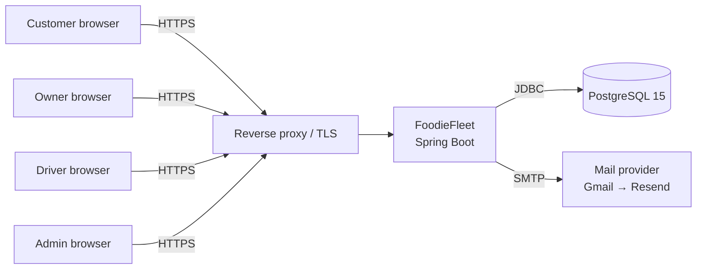
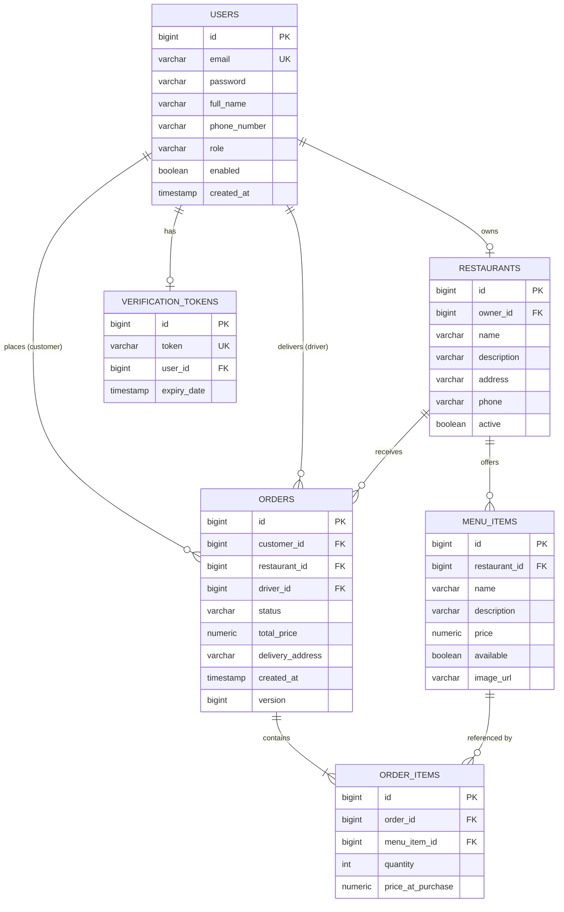
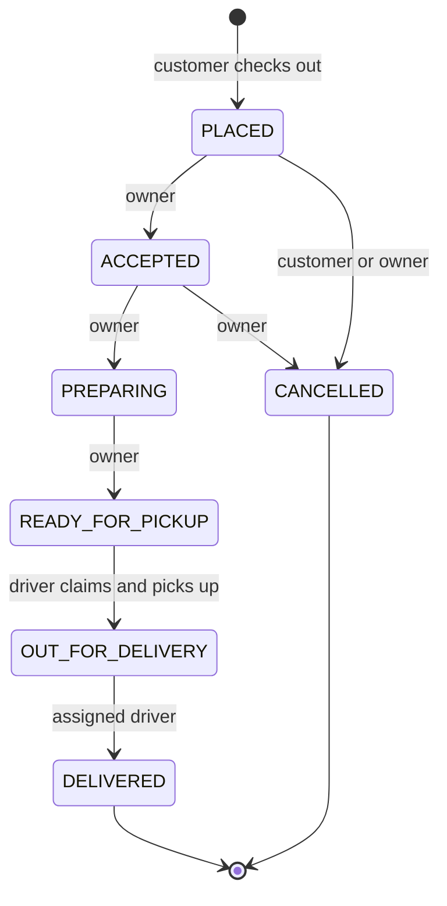

# 02 — Architecture & Design (SDLC stage 3)

Back to [SDLC.md](../SDLC.md)

## 1. System context



## 2. Application layers

```
Controller (MVC, Thymeleaf views)   ← HTTP, session, CSRF, @Valid DTOs
        │
Service (business rules, @Transactional, ownership checks, state machine)
        │
Repository (Spring Data JPA)
        │
PostgreSQL
```

Rules:
- Controllers never touch repositories directly.
- Controllers take and return **DTOs** or view models. Entities are not bound straight from forms, to prevent mass-assignment (see SECURITY.md S1).
- **Authorization lives in the service layer.** URL rules in `SecurityConfig` are the first gate; services enforce ownership.
- Side effects (email) are `@Async` and fire **after commit** (`@TransactionalEventListener(phase = AFTER_COMMIT)`), so no email goes out for a rolled-back registration.

## 3. Package structure

```
com.foodiefleet.app
├── config/        SecurityConfig, AsyncConfig (thread pool), WebConfig
├── security/      CustomUserDetailsService, CurrentUser helper
├── controller/    AuthController, CustomerController, RestaurantController, DriverController, AdminController
├── service/       AuthService, EmailService, RestaurantService, OrderService, CartService, AdminService
├── repository/
├── model/         entities + enums
├── dto/request|response
└── exception/     ResourceNotFoundException, AccessDeniedException mapping, GlobalExceptionHandler
```

Should the codebase grow, consider package-by-feature (`auth/`, `restaurant/`, `order/`, …).

## 4. Data model



**Changes required vs. current entities:**
`users.email` unique · `restaurants.active` column added · `MenuItem.Id` → `id` ·
`Order.items` → `@OneToMany` · `orders.version` (`@Version`) · `orders.updated_at`.

**Menu-item deletion:** past `order_items` reference menu items, so deleting a menu item that
has orders would break the FK. Use **soft delete** (`deleted` flag) or block deletion once
orders exist.

## 5. Order lifecycle

Proposed status set. `ACCEPTED` and `READY_FOR_PICKUP` are new, and `DELIVERD` gets fixed to `DELIVERED`:



Implement it as a method on the enum, e.g. `boolean canTransitionTo(OrderStatus next, Role actor)`.
`OrderService` rejects any other transition with a 409.

## 6. Security design

- Session-based auth for the Thymeleaf UI. CSRF on.
- `SecurityConfig` URL rules by role. Services call a `CurrentUserService.get()` that loads the
  `User` entity from `SecurityContextHolder` (replacing the `1L` placeholder).
- Ownership check pattern:

```java
MenuItem item = menuItemRepository.findById(id)
        .filter(i -> i.getRestaurant().getOwner().getId().equals(currentUser.getId()))
        .orElseThrow(() -> new ResourceNotFoundException("Menu item", id));
```

- Future REST API: a separate `SecurityFilterChain` for `/api/**`, stateless, JWT bearer tokens,
  CSRF off for that chain only.

## 7. Key technical decisions (ADR log)

| # | Decision | Rationale |
|---|---|---|
| ADR-1 | Server-rendered Thymeleaf monolith | Fastest path to a working product for a small team |
| ADR-2 | PostgreSQL | Relational data, strong consistency, good Spring support |
| ADR-3 | Session auth now, JWT later | Sessions + CSRF are simpler and safer for browser UI |
| ADR-4 | Flyway for schema | Reproducible, reviewable schema changes; replaces `ddl-auto=update` |
| ADR-5 | Testcontainers for integration tests | Tests run against real Postgres, same as prod |
| ADR-6 | Optimistic locking on `Order` | Prevents double-claiming by drivers without DB-level locks |

Add new ADRs here, or as `docs/adr/NNN-title.md` if they need more than a line.
