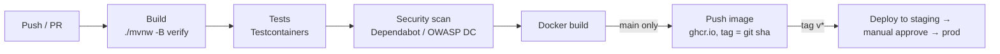

# 05 — Deployment (SDLC stage 6)

Back to [SDLC.md](../SDLC.md)

## 1. Environments

| Env | Purpose | How | Spring profile |
|---|---|---|---|
| Local | Development | IDE + `docker compose up -d postgres` | `dev` |
| Docker local | Full-stack smoke test | `docker compose up --build` | `dev` |
| CI | Automated tests | GitHub Actions + Testcontainers | `test` |
| Staging | Pre-release validation | Same image as prod, separate DB | `prod` |
| Production | Live | Container host / PaaS behind TLS proxy | `prod` |

Select the profile with `SPRING_PROFILES_ACTIVE`.

## 2. Ports (current)

| Context | App | Postgres |
|---|---|---|
| IDE (`spring-boot:run`) | 8080 | localhost:5433 |
| Docker Compose | host 8081 → container 8080 | host 5433 → container 5432 |

## 3. Container improvements (M6)

```dockerfile
# Build stage
FROM maven:3.9-eclipse-temurin-17 AS build
WORKDIR /app
COPY pom.xml .
RUN mvn -q dependency:go-offline          # cache dependencies layer
COPY src ./src
RUN mvn -q clean package -DskipTests

# Run stage
FROM eclipse-temurin:17-jre
RUN useradd --system --uid 1001 app
WORKDIR /app
COPY --from=build /app/target/*.jar app.jar
USER app
EXPOSE 8080
ENTRYPOINT ["java", "-XX:MaxRAMPercentage=75", "-jar", "app.jar"]
```

Compose additions:
- Postgres `healthcheck` (`pg_isready`) and app `depends_on: postgres: condition: service_healthy`
- Bind the DB port to localhost only: `"127.0.0.1:5433:5432"`
- Drop the obsolete top-level `version:` key
- Pass `SPRING_PROFILES_ACTIVE`

## 4. CI/CD pipeline (GitHub Actions)



Minimal `.github/workflows/ci.yml`:

```yaml
name: CI
on: [push, pull_request]
jobs:
  build:
    runs-on: ubuntu-latest
    steps:
      - uses: actions/checkout@v4
      - uses: actions/setup-java@v4
        with: { distribution: temurin, java-version: '17', cache: maven }
      - run: ./mvnw -B verify
      - run: docker build -t foodiefleet:${{ github.sha }} .
```

## 5. Release process

1. All milestone issues closed; `main-dev` green.
2. Update `CHANGELOG.md`: move **Unreleased** to `[x.y.z] — date`.
3. Bump `<version>` in `pom.xml` (drop `-SNAPSHOT`).
4. PR `main-dev → main`; merge; tag `vx.y.z`; push tag.
5. CI builds and pushes the image; deploy to staging; run the [release checklist](04-testing.md#6-release-test-checklist-manual).
6. Promote to production. Bump `pom.xml` to the next `-SNAPSHOT` on `main-dev`.

## 6. Production configuration checklist

- [ ] `SPRING_PROFILES_ACTIVE=prod`
- [ ] `spring.jpa.hibernate.ddl-auto=validate`; Flyway runs migrations on startup
- [ ] No default credentials; all secrets from the environment / secret manager
- [ ] `APP_BASE_URL=https://…`
- [ ] TLS at the proxy; `server.forward-headers-strategy=framework`
- [ ] Session cookie `Secure`, `HttpOnly`, `SameSite=Lax`
- [ ] Actuator: only `health` and `info` exposed, and not publicly
- [ ] Database not reachable from the public internet
- [ ] Automated daily DB backups (see [maintenance](06-maintenance.md))

## 7. Rollback

- App: redeploy the previous image tag.
- DB: Flyway migrations must be **backward compatible for one release** (expand → migrate →
  contract), so an old image still runs against the new schema. Destructive changes ship in a later release.
